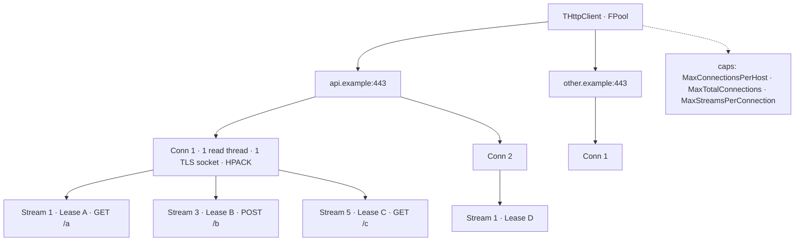
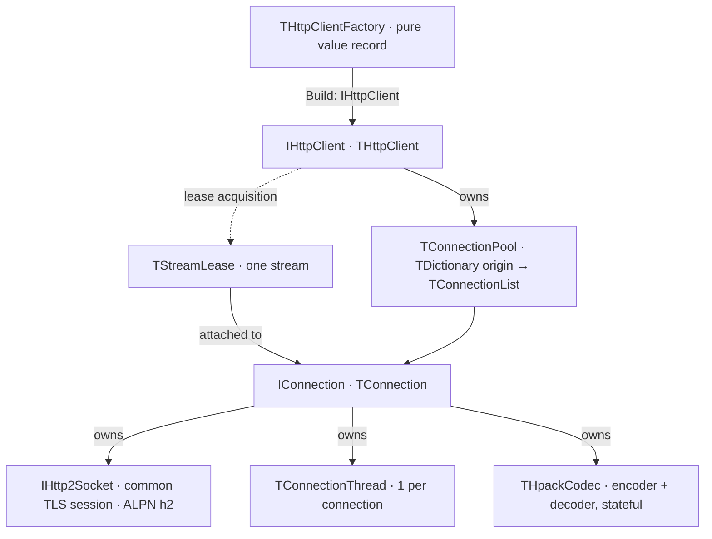

# Architecture

## Resolved multiplexing model

The pool is capped by total connections and leases queue frames on the
connection they are attached to. The model that reconciles the two, and on
which the rest of the design depends, is:

- **A lease is one HTTP/2 stream, not one TCP connection.** A single
  connection multiplexes many concurrent leases/streams.
- **Two connection caps bound TCP connections**: `MaxConnectionsPerHost`
  caps concurrent connections to one `host:port`, and `MaxTotalConnections`
  caps them across all hosts combined. Neither is a cap on in-flight
  requests.
- **Concurrency of requests is bounded separately** by
  `MaxStreamsPerConnection` (and by the peer's advertised
  `SETTINGS_MAX_CONCURRENT_STREAMS`).
- When a new lease is requested, the client reuses the least-loaded open
  connection for that `host:port` if it has a free stream slot; otherwise it
  opens a new connection (until `MaxConnectionsPerHost` /`MaxTotalConnections`);
  otherwise the lease waits.

## Component diagram

Layering, top down:

1. **`THttpClientFactory`** — immutable builder record; produces a configured
   `IHttpClient`. Details are in [client-api](client-api.md).
2. **`IHttpClient` / `THttpClient`** — public entry point, thread-safe,
   owns the pool, hands out leases. `Send` may be called concurrently.
3. **`TConnectionPool`** — `TDictionary<string, TConnectionList>` guarded by
   a `TCriticalSection`. Enforces the per-host `MaxConnectionsPerHost` budget
   and the global `MaxTotalConnections` budget.
4. **`IConnection` / `TConnection`** — owns one socket, one background
   thread, and all connection-scoped HTTP/2 state (HPACK, settings, windows,
   stream-id counter). Details are in [transport](transport.md).
5. **`TStreamLease` / stream state** — one request/response exchange.

## Entry units and feature imports

The combined library has three public entry units: `Http2.Common`,
`Http2.Client`, and `Http2.Server`. The client entry provides the factory,
request, response, and client API. The server entry provides the server
factory, handler, request, and response API. Shared protocol types live in
`Http2.Common`.

Client features use explicit `Http2.Client.*` units. A client that needs a
proxy, SOCKS, HTTP/1.1, SSE, or WebSocket feature names the feature unit in its
`uses` clause. The client facade does not promise to re-export every feature.
The `Http2` source umbrella is removed. `Http2.Client` is the public client
entry unit. It does not replace the feature imports of every former unit.

`Http2.Client.Readers` is optional. It holds JSON and XML helpers and depends
on the related FCL reader units. The core client package does not require it.
The current split units are listed in the [migration map](../../migration-0.30.0.md).
Connection, stream, pool, transport, and WebSocket helpers have separate
units. Existing declared interface GUIDs remain in use, and shared aliases
resolve to the common type identities.

Client units depend on common units. Common units have no client or server
dependencies. Client units have no server dependencies. This keeps both roles
usable in one process without an interface cycle.

Conventions:

- **Unit names**: `Http2.Client.<Area>`, dotted, one class per unit where practical.
- **Types**: `T` prefix for classes/records, `I` prefix for interfaces,
  `E` prefix for exceptions, `F` prefix for fields.
- **Parameters**: `A` prefix (`ARequest`, `AValue`), `const` for managed
  types (avoids an implicit copy + refcount churn).
- **Header-name constants** are lowercase (`HeaderContentType` = `'content-type'`)
  because HTTP/2 requires lowercase on the wire. Details are in [messages](messages.md).

## RFC references

- [RFC 1928](https://www.rfc-editor.org/rfc/rfc1928.html), checked 2026-11-11.

## TLS provider boundary

The client role accepts `ITLSContext` through `WithTlsContext`. The context
creates a separate session for every connection. It can be shared across
threads because policy is immutable; a session remains serialized by its
transport owner. The OpenSSL and TlsLib providers live in separate packages.
The client core has no provider imports. HTTPS proxy TLS uses
`WithProxyTlsContext`, which selects a separate trust policy from the origin.
The [common TLS contract](../common/tls-context.md) describes lifetime and
trust separation.
