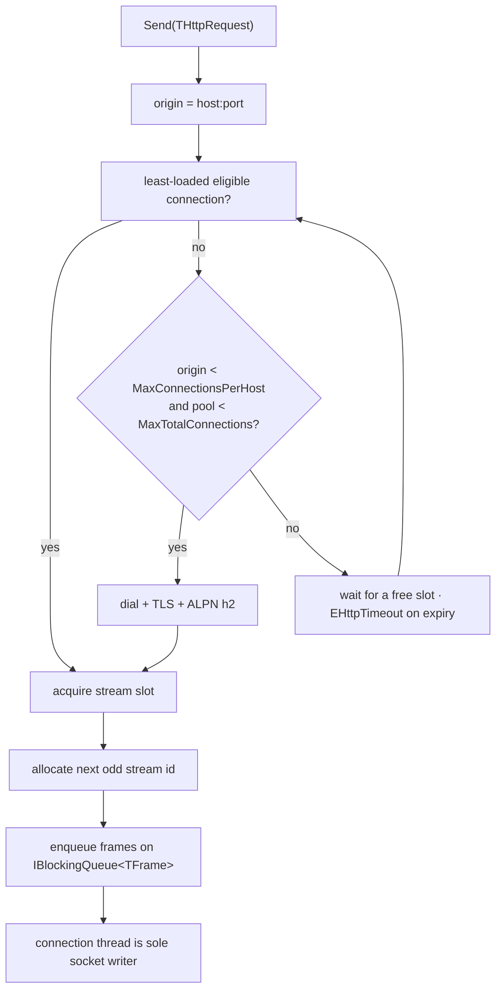

# Client API

## HttpClientFactory

```pascal
type
  THttpClientFactory = record
  private
    FMaxConnectionsPerHost: Integer;
    FMaxTotalConnections: Integer;
    FMaxStreamsPerConnection: Integer;
    FFollowRedirects: Boolean;
    FMaxRedirects: Integer;
    FConnectTimeoutMs: Integer;
    FHeaderTimeoutMs: Integer;
    FIdleTimeoutMs: Integer;
    FProxyHost: string;
    FProxyPort: Word;
    FSocketFactory: IHttp2SocketFactory;   // test seam / custom transport
    FObserver: IHttp2Observer;
    FRequestObservers: TArray<IHttpClientObserver>;
    FLogger: IHttpLogger;
    FHttp1Fallback: Boolean;
    FClearTextPolicy: TClearTextPolicy;
  public
    class function Create: THttpClientFactory; static;
    function WithMaxConnections(const AMax: Integer): THttpClientFactory;
    function WithMaxConnectionsPerHost(const AMax: Integer): THttpClientFactory;
    function WithMaxTotalConnections(const AMax: Integer): THttpClientFactory;
    function WithMaxStreamsPerConnection(const AMax: Integer): THttpClientFactory;
    function WithFollowRedirects(const AFollow: Boolean): THttpClientFactory;
    function WithMaxRedirects(const AMax: Integer): THttpClientFactory;
    function WithProxy(const AHost: string; const APort: Word): THttpClientFactory;
    function WithProxySelector(const ASelector: IProxySelector): THttpClientFactory;
    function WithAllProxy(const AUrl: string): THttpClientFactory;
    function WithProxyEnvironmentVars(const AEnable: Boolean = True): THttpClientFactory;
    function WithNoProxy(const AList: string): THttpClientFactory;
    function WithProxyEnvironmentLookup(const ALookup: TEnvLookup): THttpClientFactory;
    function WithConnectTimeout(const AMs: Integer): THttpClientFactory;
    function WithHeaderTimeout(const AMs: Integer): THttpClientFactory;
    function WithIdleTimeout(const AMs: Integer): THttpClientFactory;
    function WithSocketFactory(const AFactory: IHttp2SocketFactory): THttpClientFactory;
    function WithTlsContext(const AContext: ITLSContext): THttpClientFactory;
    function WithProxyTlsContext(const AContext: ITLSContext): THttpClientFactory;
    function WithClientIdentity(const AIdentity: IClientIdentity): THttpClientFactory;
    function WithClientCertificateFiles(const ACertFile, AKeyFile: string;
      const APassphrase: string = ''): THttpClientFactory;
    function WithClientIdentitySelector(
      const ASelector: IClientIdentitySelector): THttpClientFactory;
    function WithProxyClientIdentity(const AIdentity: IClientIdentity): THttpClientFactory;
    function WithHttp1Fallback(const AEnable: Boolean = True): THttpClientFactory;
    function WithClearText(const APolicy: TClearTextPolicy): THttpClientFactory;
    function WithObserver(const AObserver: IHttp2Observer): THttpClientFactory;
    function WithRequestObserver(const AObserver: IHttpClientObserver): THttpClientFactory;
    function WithLogger(const ALogger: IHttpLogger): THttpClientFactory;
    function Build: IHttpClient;
    // read-only accessors: MaxConnections, MaxConnectionsPerHost,
    // MaxTotalConnections, MaxStreamsPerConnection, FollowRedirects,
    // MaxRedirects, ConnectTimeoutMs, HeaderTimeoutMs, IdleTimeoutMs,
    // Http1Fallback, Observer, RequestObservers, Logger
  end;
```

The factory is a **pure value record**: every `WithX` returns a new record
with one field changed, so a stored factory can be reused and forked without
shared mutable state. `Build` allocates the `IHttpClient` and its pool.

Defaults:

| Setting | Default | Meaning |
|---|---|---|
| `MaxConnectionsPerHost` | `4` | concurrent TCP connections to one authority (`host:port`) |
| `MaxTotalConnections` | `32` | concurrent TCP connections across every authority combined |
| `MaxStreamsPerConnection` | `100` | concurrent streams per connection offered to the peer |
| `FollowRedirects` | `True` | automatic redirect handling (as described in [errors-redirects](errors-redirects.md)) |
| `MaxRedirects` | `10` | redirect chain limit before `EHttpTooManyRedirects` |
| `RedirectPolicy` | `rpAnyHost` | the hosts that a redirect may reach (`WithRedirectPolicy`); the table and the credential rule are in [errors-redirects](errors-redirects.md) |
| `ConnectTimeoutMs` | `10000` | TCP + TLS handshake deadline |
| `HeaderTimeoutMs` | `30000` | response-header deadline once headers are expected |
| `IdleTimeoutMs` | `60000` | idle connection reap time |
| `Http1Fallback` | `False` | allow HTTP/1.1 when the peer does not offer `h2`; as described in [fallback](fallback.md) |
| `ClearTextPolicy` | `ctReject` | reject `http` origins; `ctPriorKnowledge`, `ctUpgrade` and `ctHttp1` accept them (`ctHttp1` speaks HTTP/1.1 with no upgrade probe); as described in [fallback](fallback.md) |

`rpAnyHost` follows a redirect to any host. The only protection in that default
is the removal of the `authorization`, `cookie` and `proxy-authorization` headers
on a change of origin. A caller that sends secrets in other headers selects
`rpSameOriginOnly`.

Two connection caps apply, because a pool has two different budgets: a
**per-authority** one (how many TCP connections may serve one `host:port`, a
parallelism/reuse decision) and a **pool-wide** one (how many file descriptors
and TLS states the client may hold in total, a resource decision).
`MaxStreamsPerConnection` is the per-connection request cap and is applied on
top of the peer's `SETTINGS_MAX_CONCURRENT_STREAMS` (whichever is smaller).

RFC 9113 section 9.1 says a client *SHOULD NOT* open more than one HTTP/2
connection to a given host and port, so `MaxConnectionsPerHost = 1` is the
most conformant choice and is what a single-authority client wants. The
default of `4` keeps headroom for a small number of connections to share the
load; raise it only with a measurement. High-concurrency workloads that would
rather open a few connections than expose very wide multiplexing should lower
`MaxStreamsPerConnection` (say to `20`–`50`) and set
`MaxConnectionsPerHost` in the `1`–`4` range, e.g. `WithMaxConnectionsPerHost(2)`
with `WithMaxTotalConnections(128)`.

`WithMaxConnections(max)` is a shorthand: it sets **both** caps to `max`,
which suits a single-authority pool. `WithMaxConnectionsPerHost` and
`WithMaxTotalConnections` configures each cap separately. A high-concurrency
client uses the caps to bound each host tightly while allowing many hosts.

`WithProxy(host, port)` routes every dial that the no-proxy list does not
exempt through an HTTP `CONNECT` tunnel to `host:port`; the tunnel is
established on the plain socket, so TLS and ALPN still target the origin. A
proxy that refuses the `CONNECT` surfaces as `EHttpConnectionError`; there is
no forwarding mode and no silent direct fallback. Details are in [transport](transport.md).

Three further methods choose the route per request. `WithProxyEnvironmentVars`
reads `http_proxy`, `https_proxy`, `all_proxy` and `no_proxy` when the client
is built and is off by default. `WithAllProxy(url)` is the manual counterpart
of `all_proxy`: one proxy URL, including `https://` and `socks5://` forms with
credentials, for every scheme without a more specific proxy. `WithNoProxy(list)` adds hosts that always connect directly
and accepts the `no_proxy` grammar. `WithProxySelector(selector)` installs an
`IProxySelector`, whose `SelectProxy(uri)` returns the proxy for a request or
`nil` for a direct connection; a selector overrides every other proxy setting.
Precedence, grammar, pooling and error behaviour are described in [proxy](proxy.md).

The three timeout setters take a single value each — `WithConnectTimeout`,
`WithHeaderTimeout`, `WithIdleTimeout` — and override the matching default
below for every request on the built client. Details are in [errors-redirects](errors-redirects.md).

`WithSocketFactory` replaces the transport wholesale. It is the seam the
suite uses for an in-memory transport and the hook for a caller who supplies a
custom TLS stack. The default socket factory uses the context from
`WithTlsContext` for HTTPS origins. `WithProxyTlsContext` selects a separate
context for an HTTPS proxy. The proxy and origin contexts do not inherit each
other's trust policy. HTTPS without a client context fails before DNS or
socket creation. A nonempty `WithCACertFile` or `WithInsecureTls(True)` raises
a configuration error; trust and verification
are configured on the provider context.

`WithClientIdentity` accepts the common `IClientIdentity` alias for
`ITLSIdentity`. `WithClientCertificateFiles` is a compatibility method that
raises a configuration error. Identities are loaded through the selected
provider facade. `WithClientIdentitySelector` asks an
`IClientIdentitySelector` for each new origin connection. A nil result
suppresses the context default identity. `WithProxyClientIdentity` selects
identity for the HTTPS proxy leg only. Pool keys include origin and proxy
context identity and the selected identity. See [TLS context](../common/tls-context.md),
[provider docs](../tls/openssl.md) and [mTLS](mtls.md). `WithObserver` installs an `IHttp2Observer` for connection,
stream, and frame-level events — as described in [testing-observability](testing-observability.md).

`WithRequestObserver` installs an `IHttpClientObserver`, the request-level
seam above `IHttp2Observer`. Each call adds an observer: start callbacks run in
registration order and end callbacks in reverse. An observer is told when each
attempt (a request, a redirect hop, a transparent retry) starts, receives the
response headers, a redirect or a retry, and is told once when the attempt
ends, which is when the body finishes or the response is released. It may
inject headers into each attempt through `THttpAttempt.Headers`; the request
the caller built is never modified. `THttpRequest.WithContext` attaches an
opaque object that reaches the observer in `THttpAttempt.Context` on every
attempt. A client with no request observer pays one nil check per `Send`.
`WithLogger` installs an `IHttpLogger`, which receives a warning when an
observer raises (the exception is otherwise swallowed). The full contract is
in [request-observability](request-observability.md).

### TLS and trust

The default socket factory uses `ITLSContext` for TLS. The secure client
policy verifies the certificate path and the expected server name. Trust
anchors and the optional system trust setting belong to that context. The
TLS provider is selected by constructing an OpenSSL or TlsLib context and
passing it to `WithTlsContext`. HTTPS proxy trust uses
`WithProxyTlsContext` independently. A context may contain client and server
policies and is safe to share; each connection creates its own session.

`WithCACertFile` with a nonempty path and `WithInsecureTls(True)` raise
configuration errors. They no longer configure peer trust. Explicit insecure
operation is available through `TTlsClientPolicy.WithInsecure` before the
provider factory builds the context. The provider capability list reports
features supported by each implementation.

Fluent use:

```pascal
var
  Client: IHttpClient;
begin
  Client := THttpClientFactory.Create
    .WithMaxConnectionsPerHost(2)
    .WithMaxTotalConnections(8)
    .WithMaxStreamsPerConnection(50)
    .WithFollowRedirects(False)
    .Build;
end;
```

### Unix domain sockets

`WithUnixSocket(APath)` sends every connection of the client to the socket file
at `APath`. The URL host and port still name the authority: they set the `Host`
header, the TLS server name and the certificate check. They do not select the
destination. `WithUnixSocket('')` clears the option.

`APath` must be absolute, hold no NUL byte and be at most 103 bytes long in
UTF-8. The same rule applies to the server option and to `WithUnixProxy`. The
dial is described in [transport](transport.md#unix-domain-sockets).

`WithUnixProxy(APath, AKind)` sets a proxy that listens on a socket file. `AKind`
is `pkHttp` by default; `pkSocks5` is also accepted. `pkHttps` is refused at
`Build`. The proxy replaces a `WithProxy` value, and the later call wins. The
route rules are in [proxy](proxy.md#a-proxy-on-a-unix-socket).

`Build` raises `EHttpUnixSocketConfigError` in these cases:

- the `WithUnixSocket` path breaks the path rule;
- the `WithUnixProxy` path breaks the path rule, or `AKind` is `pkHttps`;
- a Unix socket path is set together with any proxy source: `WithProxy`,
  `WithUnixProxy`, `WithAllProxy`, `WithProxySelector`, or a non-empty
  `http_proxy`, `https_proxy` or `all_proxy` value read from the environment.
  The environment is read only when `WithProxyEnvironmentVars` is enabled, which
  is off by default.

`EHttpUnixSocketConfigError` derives from `EHttpError`. A connect that fails
raises `EHttpConnectionError` at `Send`, and a connect that times out raises
`EHttpTimeout`.

A redirect is a new request on the same client, so the redirect target also
dials the socket file. An `http://` origin on a Unix socket follows the cleartext
policy of the client, which is `ctReject` by default; see
[fallback](fallback.md).

## HttpClient

```pascal
type
  IHttpClient = interface
  ['{6B1C2D3E-4F50-4A61-9C72-000000000001}']
    function Send(const ARequest: THttpRequest): IHttpResponse; overload;
    function Send(const ARequest: IWebSocketRequest): IWebSocket; overload;
    procedure Close;
  end;
```

`Send` **blocks until response status and headers are available**, then
returns an `IHttpResponse` whose body can be streamed or drained (as described in
[messages](messages.md)). It does not block until the body is complete. `Send` is
thread-safe and may be called concurrently from many threads; each call
acquires its own stream lease.

On HTTP/2, an idle response does not hold the connection lock while it
waits for response headers or body frames. Other streams on that connection
can send requests and read responses during the wait. Caller-side frame processing and the shared HPACK encoder use the
connection lock. The shared HPACK decoder runs only on the connection
reader thread, in wire order, before dispatch to stream queues. Header
blocks for an unregistered stream still update that decoder. The lease
releases the lock only for the inbound queue wait and acquires it again
before it processes a frame. The `IHttpResponse` object keeps the connection
alive for the full body lifetime. Callers retain that response interface while
they read its `Body`; the body interface alone does not own the lease or
connection. Automatic content decoding starts after the header
acquisition lock is released, so a decoded body has the same wait rule.

A cancellation token applies to its request. Cancellation of a blocked
stream does not cancel another stream on the same connection. This rule
applies to HTTP/2; an HTTP/1.1 connection has one active request at a time.

The second `Send` opens a WebSocket (as described in [websocket](websocket.md)): it dials a dedicated
HTTP/1.1 connection, runs the upgrade handshake and returns an `IWebSocket`
whose listener callbacks run on its own reader thread. That connection is not
pooled. A class that implements `IHttpClient` itself has to provide both
overloads.

`Close` stops accepting new leases, gracefully closes open connections
(GOAWAY, as described in [transport](transport.md)), and releases the pool. Outstanding
`IHttpResponse` bodies remain readable until they complete or the caller
releases them.

### Pool statistics

`THttpClient.PoolStats` returns a `TPoolStats` snapshot of the connection
pool: total, idle and active-stream counts, the callers parked waiting for a
slot, and per origin (the key includes the proxy route) the same counts plus a
`TConnectionStats` for each connection with its protocol, state, age, idle
time and the peer's settings. The record types and the field list are in
[request-observability](request-observability.md#pull-based-pool-statistics).

The counts are the ones the pool's own caps use: `Connections` is what
`MaxTotalConnections` bounds, `ActiveStreams` is what
`MaxStreamsPerConnection` and the peer's `SETTINGS_MAX_CONCURRENT_STREAMS`
bound, and `PendingAcquires` is the number of `Send` calls waiting for a slot.
The snapshot is copied under the pool lock and returned by value, so it is
consistent and points at nothing in the pool. On a closed client it is all
zeros. It is safe from any thread.

### Lease acquisition

`Send` performs these steps under the pool's `TCriticalSection`:

1. Compute `Origin` from the request URL (`host:port`; default port by
   scheme). This becomes the `:authority` pseudo-header.
2. Look up the connection list for `Origin` and choose the **least-loaded
   eligible** connection — one that is open (or opening) and whose active
   stream count is below both `MaxStreamsPerConnection` and the peer's
   advertised `SETTINGS_MAX_CONCURRENT_STREAMS`.
3. If none is eligible and the origin count is below
   `MaxConnectionsPerHost` and the pool count is below `MaxTotalConnections`,
   **open a new connection** for `Origin` and use it.
4. Otherwise **wait** for a slot to free (bounded by the configured
   timeouts, else `EHttpTimeout`).
5. Allocate the next odd stream id on the chosen connection, build a
   `TStreamLease`, and enqueue the request frames on the connection's
   `TBlockingQueue<TFrame>`.



The connection thread is the **sole writer** to the socket: callers never
touch the socket directly, they only enqueue frames. This keeps the HPACK encoder state and flow-control accounting single-threaded
at the socket writer. The [transport](transport.md) document describes the queue design. The [protocol](protocol.md) document describes
flow control.

## RFC references

- [RFC 9113](https://www.rfc-editor.org/rfc/rfc9113.html), checked 2026-11-11.
