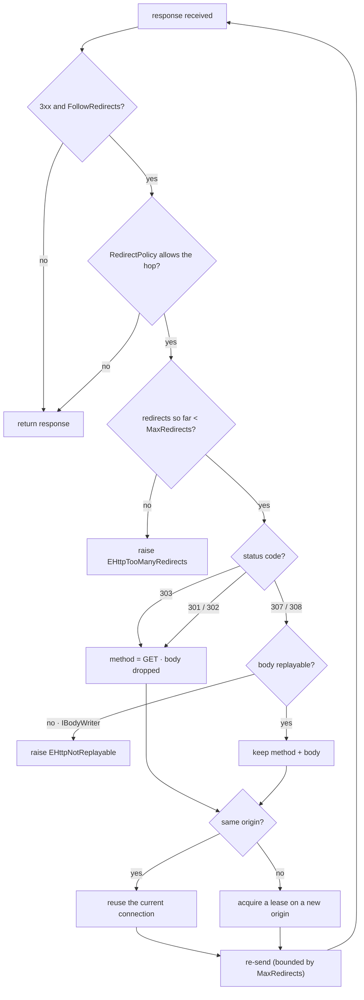
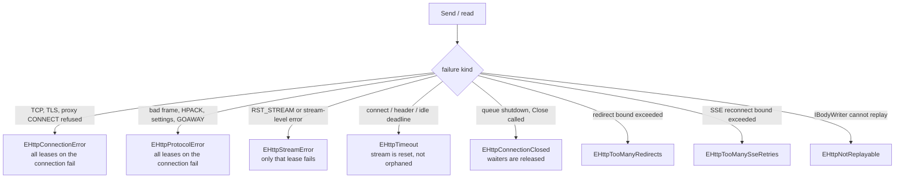

# Errors, Timeouts & Redirects

## Redirects

When `WithFollowRedirects` is on and a `3xx` carries a `Location`:

- A cross-origin redirect requires a different connection/lease; do not
  reuse the current one.
- Method/body rewriting follows the standard rules (`303` → GET, no body;
  `307`/`308` preserve method and body only if the body is a replayable
  `THttpBody`; an `IBodyWriter` body cannot be replayed and the redirect
  fails with `EHttpNotReplayable`).
- Redirect count is bounded by `MaxRedirects`; exceeding it raises
  `EHttpTooManyRedirects`.
- The proxy route is chosen again for every hop, so a redirect to a host on
  the no-proxy list connects directly and a redirect away from one goes
  through the proxy. A refused `CONNECT` raises `EHttpConnectionError`; an
  unusable proxy value raises `EHttpProxyConfigError`. Details are in [proxy](proxy.md).

### Redirect policy

`WithRedirectPolicy` selects the hosts that a redirect may reach. The policy
applies to every hop of a redirect chain. `WithFollowRedirects(False)` turns
redirect handling off, and the policy does not change that setting.

The client reads a `Location` value as a reference against the current URL
(RFC 3986 section 5.2, https://www.rfc-editor.org/rfc/rfc3986, checked 2026-11-13)
and parses the result with `ParseURI`. The policies
decide on the result:

| Policy | The client follows a redirect when |
|---|---|
| `rpAnyHost` (default) | the scheme is the same. The host and the port can differ. |
| `rpSameHostOnly` | the scheme and the host are the same. The port can differ. |
| `rpSameOriginOnly` | the scheme, the host and the port are the same. |
| `rpSameOriginUpgrade` | the origin is the same, or the only change is `http` to `https` on the same host. The port can change from the `http` port to the `https` port. |

These rules apply to every policy:

- A redirect to a scheme other than `http` or `https` is refused.
- A redirect that changes the scheme is refused. The exception is the `http`
  to `https` upgrade under `rpSameOriginUpgrade`. A redirect from `https` to
  `http` is refused under every policy.
- A refused redirect returns the 3xx response to the caller, with its headers
  and its body. The client does not raise an error for a refused redirect.
- A `307` or `308` redirect that carries a body is refused when it moves to
  another origin. A body writer that cannot be replayed raises
  `EHttpNotReplayable`, as before.
- The redirect count limit is the `MaxRedirects` setting. A refused redirect
  does not count toward that limit.

Credential headers: on a change of origin (scheme, host or port), the next
request drops `authorization`, `cookie` and `proxy-authorization`. A redirect
to the same origin keeps them. The `http` to `https` upgrade under
`rpSameOriginUpgrade` keeps them, because the host is the same and the new
transport is safer. The origin is the key of this rule, not the host. Under
`rpAnyHost` and `rpSameHostOnly`, a redirect to another port of the same host
is followed, and the credential headers are dropped for that hop.

Body headers: a `303` redirect, and a `301` or `302` redirect for a method other
than GET or HEAD, drop the body. Those hops also drop `content-length`,
`content-type` and `content-encoding`.

Replay: a `307` or `308` redirect replays the body. A body from an `IBodyWriter`
cannot be replayed, and the client raises `EHttpNotReplayable`. A producer body is
an `IBodyWriter`, so a request with a producer body raises `EHttpNotReplayable` on a
`307` or `308` redirect too. The producer runs once. It does not run again for the
redirect. A body held in memory (`WithBody`, `WithTextBody`, `WithJsonBody`,
`WithXmlBody`) is replayed.

The default policy is `rpAnyHost`. It follows a redirect to any host. The only
protection in that default is the removal of the credential headers on a change
of origin. A caller that sends secrets in another header selects
`rpSameOriginOnly`, which follows a redirect only to the same origin.



## Error handling and timeouts

Exception hierarchy (all derive from `EHttpError`):

```pascal
type
  EHttpError            = class(Exception);
  EHttpConnectionError  = class(EHttpError);   // fails all leases on the conn
  EHttpProtocolError    = class(EHttpError);
  EHttpStreamError      = class(EHttpError);   // RST_STREAM; conn survives
  EHttpTimeout          = class(EHttpError);
  EHttpConnectionClosed = class(EHttpError);
  EHttpTooManyRedirects = class(EHttpError);
  EHttpTooManySseRetries = class(EHttpError);   // SSE reconnect bound
  EHttpNotReplayable    = class(EHttpError);
  EHttpClientConfigError = class(EHttpError);   // a security option is out of range; raised at Build
```

- **Connection errors** (transport failure, protocol error, `GOAWAY`,
  `COMPRESSION_ERROR`, settings error) fail all in-flight leases.
- **Stream errors** (`ftRstStream` or stream-level protocol error) fail only
  that lease.
- **Read after the end:** a read of a response body after its end returns 0.
  The read does not raise `EHttpStreamError`, and every later read also returns
  0 (see [messages](messages.md)).
- **Writer failures:** when `NextChunk` of an `IBodyWriter` raises during an
  HTTP/1.1 upload, the connection closes. A chunked body that stops in the middle
  leaves the connection out of step, so the connection is never reused. The
  exception of the writer is raised to the caller of `Send`.
- **Producer failures:** when a producer body (see [messages](messages.md),
  "Request body from a producer") raises, the exception passes to the caller of
  `Send` unchanged. On HTTP/2 the stream is reset with `RST_STREAM(CANCEL)`, and
  the call ends. On HTTP/1.1 the connection is not reused, as for a writer.
  When the peer ends or resets the upload first, the next `Write` of the producer
  stops, and the call goes on to read the response. A peer reset then surfaces
  from the response, as for a writer.
- **Cancellation:** abandoning a `Send`/`Read` sends `RST_STREAM` with
  `CANCEL` and releases the lease. A request may carry an
  `ICancellationToken` (`THttpRequest.WithCancelToken`); cancelling it resets
  the stream in flight.
  - A producer body checks the token each time it passes a chunk to the place
    that sends it. A cancelled token makes the producer's `Write` raise
    `EHttpStreamError` with `ecCancel`. On HTTP/2 the stream is reset with
    `CANCEL`, and the call ends with that error. On HTTP/1.1 the connection is
    not reused.
  - A `Write` that already waits for flow-control credit does not wake for the
    token. The wait ends when the credit arrives, and the next chunk sees the
    token. The wait ends at the timeout of the call with `EHttpTimeout` if no
    credit arrives first.
- **Timeouts:** the factory sets three defaults — `WithConnectTimeout`,
  `WithHeaderTimeout`, `WithIdleTimeout` (milliseconds). The header timeout is
  overridable per request, through `THttpRequest.WithTimeout(ms)`
  (`0` means "use the factory default"). A timeout cancels the stream — it
  does not orphan it.
- **Body-read timeouts:** a response body read inherits the header timeout by
  default, which is wrong for a stream that is idle between messages. A
  request may set its own body-read deadline with
  `THttpRequest.WithSseReadTimeout(ms)`, where `0` means "wait indefinitely";
  the lease polls an `ICancellationToken` every 20 ms, and a cancelled or
  expired body read resets the stream with `RST_STREAM(CANCEL)`. See
  [server-sent-events](server-sent-events.md).
- **Uniform reporting:** errors are raised as the exception types above;
  partial records are never left half-owned because ownership is by
  interface (refcount cleans up on unwind).

### Where each error is raised



WebSocket failures ([websocket](websocket.md)) have their own classes, all deriving from
`EHttpError`: `EHttpWebSocketError` for misuse (an unusable URL, header,
subprotocol or argument), `EHttpWebSocketClosedError` for a send after the
output side closed, `EHttpWebSocketHandshakeError` when the server does not
accept the upgrade (it carries the status, the header lines and the first
4 KiB of the body), and `EHttpWebSocketProtocolError` when the peer breaks
RFC 6455 (it carries the close code). A WebSocket handshake never follows a
redirect. Failures after the handshake reach the listener's `OnError` instead
of being raised.

A connection-level failure **takes precedence over** a queued stream error:
if the transport dies while a retryable stream error is pending, the caller
sees `EHttpConnectionError` so the request is not silently masked as
non-retryable. Details are in [protocol](protocol.md).

## RFC references

- [RFC 6455](https://www.rfc-editor.org/rfc/rfc6455.html), checked 2026-11-11.
