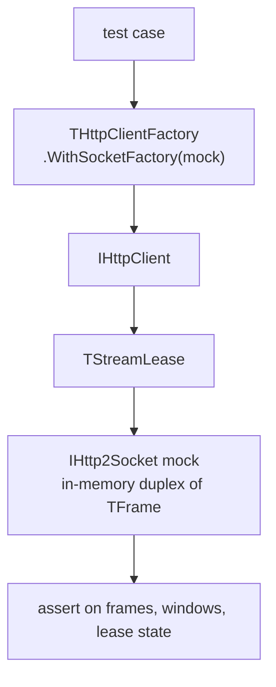
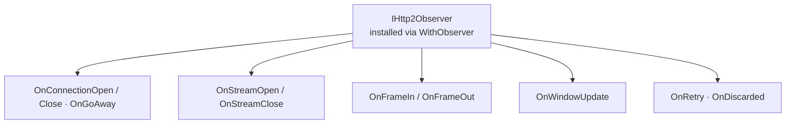

# Testing & Observability

## Test seams

The suite exercises real behaviour without a network by substituting the
transport:

- **`IHttp2Socket` mock** — `test/client/Http2.Client.MockSocket.pas` is an in-memory
duplex of `TFrame`s. The whole connection loop, HPACK, flow control, and
the lease state machine run against it.
- **`IHttp2SocketFactory`** — the factory's `WithSocketFactory` installs a
  custom transport, which is how the mock is injected in tests and how a
  caller could supply their own TLS stack.
- **Proxy routing** — `IProxySelector` and the proxy environment are pure and
  tested without a socket (`WithProxyEnvironmentLookup` replaces the process
  environment). A scripted loopback server plays an HTTP `CONNECT` proxy, an
  https proxy and a SOCKS5 proxy, and acts as the origin inside the tunnel,
  which exercises TLS inside TLS on 127.0.0.1 only. An opt-in live gate,
  `task validate:client:proxy`, drives the client through reference proxies in
  `tools/client/proxy_servers.py` and checks their logs for the route taken;
  with `nghttpd` installed it also runs strict-mode HTTP/2 through each proxy kind.
- **Pure layers** — `THpackCodec`, `TWindow`, `TFrame`/`TFrameHeader`
  serialization, and the header codec are pure enough to test in isolation.
- **`TResponseReader<T>`** — the base reader plus the optional
  `Http2.Client.Readers` JSON/XML readers are tested directly against an
  `IHttpResponse` built from a string.



## Test suite layout

The fpcunit console runner is `test/client/Http2.Client.TestRunner.pas`; the entry point
is `test/client/Http2.Client.RunTests.pas`. One test unit per source area:

| Test unit | Area |
|---|---|
| `Http2.Common.Errors.Test` | exception hierarchy and error codes |
| `Http2.Common.Frames.Test` | frame header/payload round-trips |
| `Http2.Common.Headers.Test` | header collection and constants |
| `Http2.Common.Hpack.Test` / `Http2.Client.HpackProps.Test` | HPACK codec + property tests |
| `Http2.Common.FlowControl.Test` | `TWindow` arithmetic |
| `Http2.Client.Tls.Test` | ALPN, policy, certificate checks |
| `Http2.Client.BlockingQueue.Test` | bounded blocking queue |
| `Http2.Client.ConnectionThread.Test` | per-connection thread loop |
| `Http2.Client.ConnectionLifecycle.Test` | create/drain/GOAWAY/close |
| `Http2.Client.Stream.Test` | stream state machine + `THttpBody` |
| `Http2.Client.Test` | client surface, readers, text helpers |
| `Http2.Client.Request.Test` | `THttpRequest` construction |
| `Http2.Client.Redirects.Test` | 3xx rewriting and bounds |
| `Http2.Client.Timeouts.Test` | connect/header/idle deadlines |
| `Http2.Client.Readers.Test` | JSON/XML readers and send helpers |
| `Http2.Client.Concurrency.Test` | caps and backpressure under load |
| `Http2.Client.ProbeOutcome.Test` | `TProbeOutcome` classification |
| `Http2.Client.ClearText.Test` / `Http2.Client.Http1.Test` | h2c and HTTP/1.1 fallback; a declined upgrade and `ctHttp1` send each request once (the scripted peer counts the copies it received) |

Property-style checks (HPACK `Decode(Encode(H)) = H`, window arithmetic,
and frame serialization) run alongside example-based cases. The source test
runner uses `task test` or `task test` and exits non-zero on a failure.

## Observability hooks

`IHttp2Observer` (in `client/src/Http2.Client.Observer.pas`) is installed with
`THttpClientFactory.WithObserver`:

```pascal
type
  IHttp2Observer = interface
    procedure OnConnectionOpen;
    procedure OnConnectionClose(const AMessage: string;
      const ACode: THttp2ErrorCode);
    procedure OnGoAway(const ALastStreamId: LongWord;
      const ACode: THttp2ErrorCode);
    procedure OnStreamOpen(const AStreamId: LongWord);
    procedure OnStreamClose(const AStreamId: LongWord);
    procedure OnFrameIn(const AFrame: TFrame);
    procedure OnFrameOut(const AFrame: TFrame);
    procedure OnWindowUpdate(const AStreamId: LongWord;
      const AIncrement: LongWord);
    procedure OnRetry(const AStreamId: LongWord);
    procedure OnDiscarded(const AFrame: TFrame; const AReason: string);
  end;
```



An observer is passive and must not block: callbacks fire on the connection
thread. Observers are attached per connection as it is opened, so a single
observer instance sees every connection the client creates.

`IHttp2Observer` has no request context. The request-level seam,
`IHttpClientObserver` installed with `WithRequestObserver`, reports attempts
instead of frames; as described in [request-observability](request-observability.md). The
tests for it use `TRecordingRequestObserver` in `Http2.Client.RequestObserver.Test`, a
sibling of `TRecordingObserver` that records the attempts, the outcomes and the
order of the callbacks.

## Observer adapter tests

`Http2.Client.ObserverAdapters.Test` is the integration test for the request observer
seam. It compiles against the example adapters in `examples/`
(`observer_tracing`, `observer_metrics`, `observer_logging`), which the test
target reaches through `-Fu./examples`, and drives them through the real client
and the scripted peers, so nothing needs a live server.

- **Tracing.** A redirect chain under a caller's span gives sibling child
  spans in one trace; the DECODED request headers the peer captured show
  exactly one `traceparent` per hop, naming that hop's span and replacing a
  value the caller set. Status and error, a stream failure, a retry, an SSE
  reconnect loop and an abandoned response are each asserted from the spans.
- **Metrics.** A scripted SSE stream runs under the injectable clock
  (`SetNowUsHook`): the attempt starts at one instant, a ticker observer moves
  the clock before the request is written, and the peer delivers frames at
  stamped instants. Every derived number is then compared with what the script
  fixes: time to first byte, time to first event, mean inter-event latency, max
  gap, stream duration, event and byte rates and total latency. The per-event
  histogram's bucket counts are compared with the scripted gaps and the
  histogram does not exist while the gate is off. Counters by status, the
  in-flight gauge and the pool gauge (one `PoolStats` snapshot per collection)
  are asserted around held and released responses.
- **Logging.** A frozen clock makes every time in a line 0, so the lines of a
  redirect are compared whole. The retry, abandoned, stream-failure and
  refused-before-send cases check the line, its level and its fields.
- **Composition.** The three adapters are installed together. Each behind a
  forwarding spy that notes its callbacks in one log, the order is start and
  headers in registration order and end in reverse. A tracer registered first
  records a header a later observer injected, and a later observer sees the
  `traceparent` the tracer injected. A WebSocket session against the scripted
  loopback server is observed by all three.

The recording observer in these tests is registered first, so its end callback
runs last and a wait on it means the adapters have finished. The overhead
measurement is not a test: it is `examples/observer_overhead.pas`, built by
`task examples` and run by hand (as described in [observer-overhead](../../verification/source/client/observer-overhead.md)).

## WebSocket tests

`Http2.Client.WebSocket.Test` covers the pure unit: the RFC 6455 section 5.7 frames
byte for byte, the frame parser fed one byte at a time, in random chunks and
whole, every protocol-error rule with its close code, the UTF-8 and close-code
tables, message assembly across fragments, the handshake accept and reject
matrix, request bytes, and the immutable request values.

`Http2.Client.WebSocket.Connection.Test` runs the client against a scripted loopback
server on a raw socket that checks the handshake bytes, reads masked client
frames and sends unmasked server frames: echo, demand, ping answered before
the callback, both close directions, protocol violations, handshake refusal,
bytes after the upgrade head, concurrent sends, fragmented sends, a large
message, abort, the close and ping timeouts, a raising listener, and a fresh
masking key per frame. Tests wait on events with a bounded timeout and never
sleep to wait for another thread.

`Http2.Client.WebSocket.ProtocolMode.Test` covers the choice of the protocol in `Send`: the
default mode, each mode of `WithProtocolMode`, the pooled HTTP/2 connection that `wpmAuto`
reuses (a `wpmHttp2` opening leaves it in the pool), the cleartext rules of `ws` URLs, and a
refused extended CONNECT, which does not fall back. The mock factory counts each dial as a TLS
handshake, so the tests show that `wpmAuto` makes one handshake for an HTTP/1.1 route. The
mutual-TLS suites (`Http2.Client.MutualTls.*`) check the same route with a server that selects
`http/1.1`. The observer of a WebSocket on the HTTP/2 route gets the HTTP/2 protocol; the
TLS details of a `wss` session are not reported.

The opt-in live gate (`task validate:client:websocket`) starts
`tools/client/ws_servers.py` and the proxy servers of `proxy_servers.py`,
runs `Http2.Client.WebSocketLive.Test` over `ws` and `wss`, directly and through an
HTTP `CONNECT` proxy, an `https://` proxy and a SOCKS5 proxy, and then reads
the servers' logs: every client frame carries the mask bit, the handshake
headers are as required, and the close codes and the route are as expected.
`task validate:client:cleartext` runs a bodyless `GET`, `POST`, `DELETE` and `HEAD`
under `ctUpgrade` and `ctHttp1` against `tools/client/h1_counter_server.py`,
an HTTP/1.1-only server that logs each request, and checks that each arrived
once. `task validate:client:websocket:autobahn` runs the Autobahn|Testsuite fuzzing server
(Docker) against `tools/client/autobahn_client.pas` and summarises its
report; cases 12 and 13 (`permessage-deflate`) are excluded because the client
offers no extension.

## WebSocket integration tests

`Http2.Integration.WsH2.Test` runs the library client against the library server over
h2c, with no mock. Each test starts its own server on a port that the system picks,
and `TearDown` stops it. Every wait has a limit of 10 seconds and fails with a message.
The tests cover:

- the echo of a text message and of a binary message over HTTP/2, and a ping with its pong;
- a message that the client sends in three fragments, which the server reads as one
  message in the order of the fragments;
- the close paths: a close from the client, a close from the server, and an abort, which
  the server sees as an end that is not a normal close;
- the refusals: a path with no route gives status 404, and a foreign origin under an
  allow-list gives status 403;
- the subprotocol that the server chooses from the two that it offers;
- the protocol modes: `wpmHttp2` opens over HTTP/2, and it fails against a server without
  the extended CONNECT; `wpmHttp1` and `wpmAuto` without a pooled connection use the
  HTTP/1.1 Upgrade; `wpmAuto` with a pooled HTTP/2 connection for the same origin opens
  the WebSocket on that connection, and the server counts one connection.

## WebSocket flow and error integration tests

`Http2.Integration.WsH2Flow.Test` runs the library client against the library server over
h2c, with no mock. Each test starts its own server on a port that the system picks, and
`TearDown` stops it. Every wait has a limit of 10 seconds and fails with a message. No test
sleeps for more than 2 seconds. The tests cover:

- the volume of a server message: the server streams 16 MiB with `SendStream` as 256 chunks
  of 64 KiB, and the client receives every octet in order. The client gets one frame of 16 KiB
  for each 16 KiB of the message, and one more frame with no octets and the final flag. The
  writer is asked once per chunk and once more for the end of the body;
- the back pressure: the client holds its demand at zero. The writer then stops after fewer
  than 64 of the 256 chunks, its count does not change while the demand stays at zero, and
  the rest of the message arrives after `Request` calls;
- the upload: the client sends 8 MiB as 64 binary fragments of 128 KiB, and the server reads
  one message with the octets in the order of the fragments. The server limits of the test
  are above the message and above one fragment, because the client writes each fragment as
  one frame and the default frame limit is 64 KiB;
- the message limit: a message of 2 MiB in fragments of 32 KiB closes the session with the
  code 1009 when the total passes the limit of 1 MiB. The handler starts to read the message
  when the inline limit passes, and its read then fails;
- the server stop: `Stop` ends an open session, and the listener gets `OnClose` or `OnError`
  within 10 seconds. The design of the server sends a Close frame with the code 1001 on stop;
- the reset by the server: a handler that closes with the code 1008 and a reason reaches the
  client with that code and reason, and the server sees the session end;
- the abort by the server: a handler that aborts the session sends no Close frame, and the
  listener gets `OnError`.

The tests prove these limits:

- the back-pressure test fails when the reader ignores the demand: the writer is then asked
  for every chunk. The existing test `TestSlowReaderGetsBackpressure` in
  `Http2.Integration.WsStream.Test` fails in the same way;
- the volume tests prove the exact octet counts, the exact frame counts and the order of the
  octets. They do not prove a throughput or a memory bound;
- the tests run on loopback. They do not prove the behaviour on a network with loss or
  delay;
- the abort test proves the end of a stream without a Close frame from the server's handler.
  The tests have no way to drop a TCP connection without a Close frame, so a lost connection
  at the network level is not covered;
- the server stop test accepts either callback, because the timing of the stop decides
  which callback arrives first.

## WebSocket integration tests over TLS

`Http2.Integration.WssH2.Test` runs the library client against the library server over
TLS. The server uses the certificate of `localhost` from the test PKI, which the task
`test:integration` makes. Each test starts its own server on a port that the system picks,
and `TearDown` stops it. Every wait has a limit of 10 seconds and fails with a message.
The tests cover:

- an echo over ALPN `h2`: the client opens the WebSocket with `wpmHttp2`, and the server
  handler sees the extended CONNECT with `:protocol` `websocket`;
- a verified client certificate on the WebSocket over HTTP/2: the identity of the factory,
  and the identity of the request, each reach the server handler, which reads the common
  name `alice` and the request principal `alice`;
- a 4 MiB binary message, sent and echoed over HTTP/2, against a server whose message and
  frame limits are raised to 4 MiB;
- `wpmAuto` over TLS: after an ordinary `https` request over HTTP/2, the WebSocket opens on
  the pooled connection, and the server accepts one connection in total; with no pooled
  connection, the WebSocket opens with the HTTP/1.1 Upgrade, and the server accepts one
  connection in total;
- `wpmAuto` against a server that offers `h2` alone, because its HTTP/1.1 fallback is off:
  the TLS handshake fails with `EHttpConnectionError`.

The server has no option that offers `http/1.1` alone. A server offers `h2` and `http/1.1`
when its fallback is on, which is the default, and `h2` alone when it is off. The mock tests
described above cover the route of a WebSocket with a peer that selects `http/1.1`.

## Multiplexing integration tests

`Http2.Integration.WsH2Mux.Test` runs the library client against the library server over
h2c, with no mock. The tests check how several WebSockets and requests share one
connection, and how the streams of a connection are released. Each test starts its own
server on a port that the system picks, and `TearDown` stops it. Every wait has a limit of
10 seconds and fails with a message. The server reports each accepted connection to its
observer, so a test can count the connections.

The tests cover:

- 20 WebSockets that one client opens to one origin. Each socket sends 100 messages. Each
  echo has the text that the socket sent, in the order of sending. The server reports one
  accepted connection and 20 open streams.
- An ordinary request that runs while a WebSocket is open. The request gets its answer, and
  the server still reports one connection.
- Four threads that send 250 messages each through one socket. The server checks each
  message as a whole. The echoes are the sent messages, each one time, and the messages of
  one thread keep their order.
- A close while one thread sends. The sender ends within 10 seconds with
  `EHttpWebSocketClosedError` and no other exception. The server reads exactly the messages
  whose send returned.
- 200 WebSockets that open and close one after another. After each close, the server reports
  no open stream within 5 seconds, and the server still has one connection.

The server of these tests sets `QueuedMessages` to 10000 and the message bucket to 1000000
tokens. The default queue holds 16 messages for the application. A peer that fills the queue
in a burst is closed with 1008, so the burst tests need the larger queue.
>
## Concurrency tests

`Http2.Client.Concurrency.Test` drives many threads calling `Send` against a slow
streaming mock to prove:

- the per-host (`MaxConnectionsPerHost`) and pool-wide
  (`MaxTotalConnections`) connection caps hold under contention;
- `MaxStreamsPerConnection` and the peer's
  `SETTINGS_MAX_CONCURRENT_STREAMS` bound concurrent requests;
- backpressure throttles the caller instead of buffering without limit.

## RFC references

- [RFC 6455](https://www.rfc-editor.org/rfc/rfc6455.html), checked 2026-11-11.
