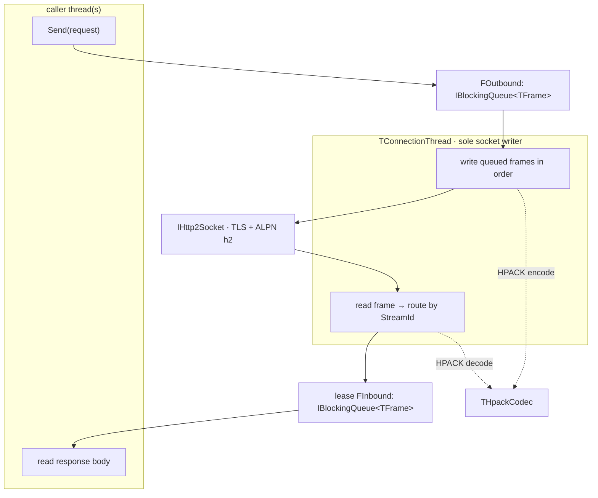
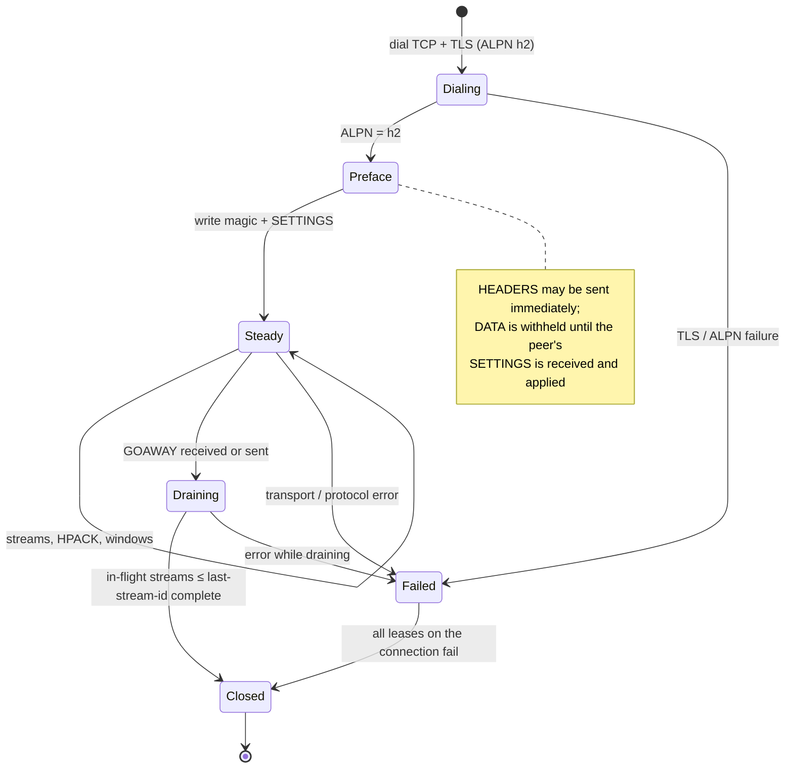

# Transport, Threads & Connection Lifecycle

## Threading and queues

Free Pascal 3.2.4 primitives (all choices below are probe-verified; see
[fpc-runtime](fpc-runtime.md)):

- `TThread` (unit `Classes`) — one subclass per connection,
  `TConnectionThread`.
- **`TBlockingQueue<T>` — the outbound and inbound frame queues.** FPC 3.2.4
  has **no `TThreadedQueue<T>`** (`Identifier not found "TThreadedQueue"`),
  so the design defines its own bounded, blocking queue from
  `TQueue<T>` (unit `Generics.Collections`), a `TCriticalSection`, and two
  `RTLEvent`s. `probe12.pas` compiles and runs it (a consumer thread drains
  100 items; sum = 5050), including a `Shutdown` that releases blocked
  waiters. **It is held as an interface**
  (`IBlockingQueue<T>`) so a thread and a caller can share one queue by
  refcount rather than by raw pointer.
- **Arrival stamps.** The connection thread reads `Http2.Client.Clock.NowUs` once
  per received frame, right after the frame is read, and the stamp travels
  with the frame through the stream's inbound queue. A stream's queue is
  bounded (`cDefaultQueueCapacity`, 128 frames) and `Push` blocks the thread
  when it is full, so a consumer that stops reading for 128 frames delays the
  stamps of every stream on that connection; window credit is returned on
  arrival, so flow control is unaffected. See
  [request-observability](request-observability.md), "Arrival stamping".
- `TCriticalSection` (unit `SyncObjs`) — the pool guard, and per-connection
  stream-id allocation even though the object is free-threaded
  (`TMonitor` is **not** in FPC 3.2.4; `Identifier not found "TMonitor"`).
- `RTLEvent` (unit `Classes`) — slot signalling and queue wakeups.
  **Use `RTLEvent`, not `TEvent`/`TSimpleEvent`**: on macOS both constructs
  raise `ESyncObjectException: Failed to create OS basic event` (probe6,
  probe11), while `RTLEventCreate`/`RTLEventSetEvent`/`RTLEventWaitFor`
  works (probe7).
- `{$IFDEF UNIX}cthreads,{$ENDIF}` must precede threaded units in any
  program's `uses`; otherwise: `This binary has no thread support compiled
  in ... Runtime error 232`.

```pascal
{$mode delphi}
type
  IBlockingQueue<T> = interface
    procedure Push(const AItem: T);
    function Pop(out AItem: T): Boolean;   // False on shutdown + empty
    procedure Shutdown;                    // releases blocked waiters
  end;

  TBlockingQueue<T> = class(TInterfacedObject, IBlockingQueue<T>)
  private
    FLock: TCriticalSection;
    FNotEmpty: PRTLEvent;
    FNotFull: PRTLEvent;
    FItems: TQueue<T>;
    FCapacity: Integer;
    FShutdown: Boolean;
  public
    constructor Create(const ACapacity: Integer = 128);
    destructor Destroy; override;
    procedure Push(const AItem: T);
    function Pop(out AItem: T): Boolean;
    procedure Shutdown;
  end;

  TConnectionThread = class(TThread)
  private
    FConn: Pointer;             // weak ref to TConnection (no AddRef)
    FOutbound: IBlockingQueue<TFrame>;
    FInbound: IBlockingQueue<TFrame>;
    FSocket: IHttp2Socket;
  protected
    procedure Execute; override;
  public
    constructor Create(AConn: TConnection);   // does NOT retain AConn
  end;
```

One thread per connection, responsible for *both* directions:

- **Outbound:** a `Send`/`Read` caller never writes to the socket. It pushes
  frames onto `FOutbound` and returns (or blocks on `FInbound`). The
  connection thread writes them in queue order.
- **Inbound:** the thread reads frames and, keyed by `StreamId`, pushes them
  onto that lease's `FInbound`. Frames for unknown/closed streams (late DATA
  after `RST_STREAM`) are discarded and counted.
- **Ordering:** frames for one stream are written in enqueue order;
  `HEADERS`/`CONTINUATION` must be contiguous and `DATA` must follow its
  `HEADERS`. The single writer guarantees this by construction.
- **Backpressure:** `TBlockingQueue` has a bounded depth; a full outbound
  queue blocks (or returns a retryable error) instead of growing unbounded.
  A full inbound queue applies flow-control pressure via window updates. On
  shutdown, `Shutdown` unblocks waiters and pending calls fail with
  `EHttpConnectionClosed` rather than hanging.
- **Contention:** the HPACK encoder is stateful and shared across streams.
  Encoding is therefore routed through the connection thread (or guarded by
  the connection's critical section); the decoder is touched only by the
  connection thread.
  Complete HEADERS/CONTINUATION blocks are decoded before stream lookup.
  This includes header blocks for a stream whose lease was released. The
  END_HEADERS frame carries decoded fields as internal metadata; those fields
  are not written to the socket. Each lease validates the fields and updates
  its response state on the caller thread. A caller can consume streams in
  any order without changing the HPACK dynamic-table order. Interleaved or
  wrong-stream CONTINUATION frames fail the connection.
- **ARC hazard:** `TConnectionThread` stores a raw (weak) pointer to avoid
  an interface reference cycle (`TConnection` ↔ thread). `TConnection`
  `Terminate`+`WaitFor`s the thread before releasing `FSocket`/queues.
  The queues themselves are interfaces, so both sides can hold one without
  a raw-pointer lifetime bug.



## Connection lifecycle

1. **Create.** TCP opens, then TLS negotiates ALPN `h2`. When ALPN selects `h2`,
   the client writes the connection preface: the client magic
   `PRI * HTTP/2.0` + CRLF + CRLF + `SM` + CRLF + CRLF, then a `SETTINGS`
   frame. The connection can open streams as soon as the preface is written:
   a request may send `HEADERS` immediately, since HEADERS is not
   flow-controlled. `DATA`, however, is withheld until the peer's `SETTINGS`
   is received and applied, because only then is
   `SETTINGS_INITIAL_WINDOW_SIZE` known — the default is 65535, but a peer
   may lower it, and emitting DATA first would overrun its window
   (RFC 9113 section 6.5.3: `FLOW_CONTROL_ERROR`).
2. **Steady state.** The connection serves streams and maintains HPACK tables, settings, and
   windows.
3. **Keep-alive.** Idle connections may be probed with `PING` and closed
   after `FIdleTimeoutMs`, provided no active streams.
4. **`GOAWAY`.** The connection enters a draining state and stops creating new streams. Streams with ids
   at or below the last-stream-id may complete; **higher streams may be
   safely retried on a fresh connection (the peer guarantees it did not
   process them).** A stream that may have been processed is retried only when
   the request is known to be safe. An unusable connection leaves the pool,
   and the client opens a replacement.
5. **Errors.** A transport/protocol error fails all leases on that
   connection; `ftRstStream` fails only the affected lease.
6. **Shutdown.** `IHttpClient.Close` stops accepting leases, drains or
   cancels in-flight streams, sends `GOAWAY` where possible, stops every
   `TConnectionThread` (`Terminate`+`WaitFor`), and closes sockets.
   Idempotent.



`GOAWAY` semantics: streams with ids **above** the last-stream-id were never
processed by the peer, so they may be retried on a fresh connection; streams
at or below it may have been processed and are only retried if the method is
known safe.

**Reconnect policy**: transparent retry on connection failure only for
idempotent methods (no body writer), and only on `ecRefusedStream` or a
`GOAWAY` that puts the stream above the last-stream-id; bounded by
`cMaxTransparentRetries`. There is no per-request opt-in.

## TLS and ALPN

- HTTPS requires a client-capable `ITLSContext` selected with
  `WithTlsContext`. Without one, a library-owned HTTPS dial fails before DNS
  or socket creation.
- The client offers ALPN `h2`. If the server does not select `h2`, the client
  raises `EHttpProtocolError` by default. HTTP/1.1 fallback requires explicit
  caller policy. `NPN` is not required.
- Cleartext `h2c`, cleartext HTTP/1.1, and HTTP/1.1 fallback remain separate
  transport settings. The strict default remains unchanged. Details are in
  [fallback](fallback.md).
- The context owns trust and hostname verification policy. The secure client
  policy verifies both by default. A nonempty `WithCACertFile` or
  `WithInsecureTls(True)` raises a configuration error.
- Each connection owns a provider-neutral buffer session. The session moves
  ciphertext and plaintext through bounded queues and performs no socket I/O.
  OpenSSL and TlsLib provide the same session contract. A client identity is
  selected as common `ITLSIdentity` metadata; a nil selector result suppresses
  the context default.
- HTTPS proxy TLS uses `WithProxyTlsContext`. Proxy trust and proxy identity
  are separate from the origin context and identity. A `CONNECT` tunnel then
  carries the origin TLS layer. See [proxy](proxy.md) and [mutual TLS](mtls.md).


## Unix domain sockets

A client built with `WithUnixSocket` dials a Unix domain socket file in place of
a TCP address. The socket file path replaces the TCP address for every connection
of that client. TLS, ALPN, HTTP/1.1, HTTP/2, server-sent events and WebSocket
run over the same byte stream, so the protocol code does not change. The option
is described in [client API](client-api.md) and the route rules in [proxy](proxy.md).

### Dial rule

- `Build` gives the client a clone of the default socket factory that holds the
  socket file path. The shared factory stays on TCP.
- The clone sends every dial to the file: the pool, TLS, cleartext, the HTTP/1.1
  dial that a WebSocket uses, and the dial of each redirect hop. The URL host and
  port do not select the destination.
- The client opens an `AF_UNIX` stream socket and connects it without blocking.
  When the connect completes, the descriptor returns to blocking mode.
- A connect that fails at once, or that reports an error through `SO_ERROR`,
  raises `EHttpConnectionError`. The message holds the path and the system error
  text.
- A connect that reports `EAGAIN` is retried every 10 ms until the connect timeout
  ends. A connect that is still pending at the deadline raises `EHttpTimeout`.
  On macOS a full listen queue is reported as `ECONNREFUSED` instead, so that
  case raises `EHttpConnectionError` at once.
- The path rule is checked before the connect. A path that is not absolute,
  holds a NUL byte or is longer than 103 UTF-8 bytes is refused by `Build`
  with `EHttpUnixSocketConfigError`. A leading `@` is therefore refused: the
  client does not use Linux abstract sockets.

### Timeouts

- The connect deadline is the connect timeout of the dial. For a Unix socket it
  covers the connect only.
- The read and write deadlines are fixed at 30 000 ms, as on a direct TCP
  connection. The factory does not change them for a Unix socket.

### Write path and SIGPIPE

- Every write to the socket goes through `SocketWriteFully`, including the
  ciphertext of TLS. That function calls `send` with the flag `cMsgNoSignal`.
- On Linux the flag is `MSG_NOSIGNAL`. A write to a peer that has closed returns
  `EPIPE` and does not raise `SIGPIPE`.
- On macOS the flag is 0. The descriptor carries `SO_NOSIGPIPE`, which the client
  sets when it creates the socket, and the write does not raise `SIGPIPE` for the
  same reason. The return value of that `setsockopt` call is not checked.
- A failed write raises `EHttpConnectionClosed`, and a write that times out raises
  `EHttpTimeout`.
- The OpenSSL provider moves TLS data through memory BIOs. OpenSSL does not write
  the descriptor, so the production client path does not enter the per-call
  SIGPIPE shield of `Http2.Client.SigPipe`. The shield is used by the tests only.
- The client does not install a signal handler and does not change the signal
  disposition of the process.

### Authority rule

- The URL host and port set the `Host` header, the TLS server name and the
  certificate check. The socket file does not change them. For example,
  `http://localhost/x` over a Unix socket sends `Host: localhost`.
- A Unix path replaces the whole route. The proxy check does not apply to a Unix
  dial, and a client with a Unix path refuses every proxy source at `Build`.

## WebSocket connections

A WebSocket ([websocket](websocket.md)) uses a connection of its own rather than a pooled
one. The dial speaks HTTP/1.1 only: for `https` the ALPN offer is `http/1.1`
alone (`IHttp1SocketFactory.DialHttp1`), a server that selects `h2` is
refused, and a server that answers with no ALPN is accepted. The proxy tunnels
of [proxy](proxy.md) apply unchanged. After the `Upgrade` handshake one reader thread
owns every read of the socket; sends from other threads are serialised by a
lock, and on a connection whose reads and writes share one TLS state the
socket itself is guarded by a second lock that the reader takes only for short
polls.

## RFC references

- [RFC 9113](https://www.rfc-editor.org/rfc/rfc9113.html), checked 2026-11-11.
