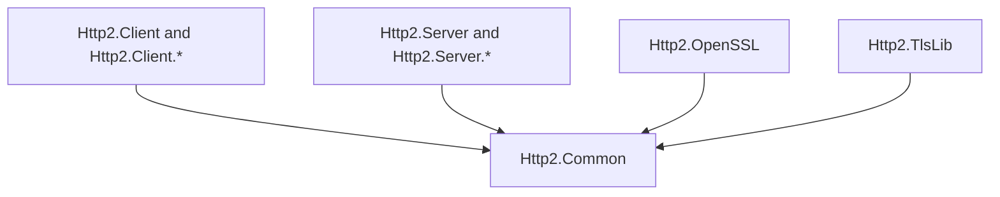

# Common architecture

## Public entry units

The combined library has five public entry units. `Http2.Common` provides
shared protocol types and operations. `Http2.Client` provides client factories,
requests, responses, and the client API. `Http2.Server` provides server
factories, handlers, requests, and responses. `Http2.OpenSSL` and
`Http2.TlsLib` provide separate TLS implementations of the common context.

The common implementation has no dependency on client or server units. Client
units depend on common units and client units. Server units depend on common
units and server units. Client and server units do not depend on each other.
Interface dependency cycles are not part of the design.

The five production source roots are `common/src`, `client/src`,
`server/src`, `tls/openssl/src`, and `tls/tlslib/src`. Each root contains units
with its matching namespace. A common-only build has no role or provider
dependency. Client and server core builds do not load a TLS provider. Provider
packages depend on common, and applications select a provider through the
common context interface.

## Shared protocol ownership

`Http2.Common.Errors` owns the common exception hierarchy and error codes.
`Http2.Common.Headers` owns the shared header API. `Http2.Common.Hpack` owns
the header compression codec and records. `Http2.Common.Frames` owns frame
formats and shared settings operations. `Http2.Common.FlowControl` owns
connection and stream credit operations. `Http2.Common.Body` owns the body writer
interfaces `IBodyWriter` and `IBodyReader`, the buffer `TChunkBuffer`, and the helpers
that read a body to its end; see [body](body.md). The interfaces `IBodyChunkSink`
and `IBodyProducer` belong to the same unit. `Http2.Common.Body.Producers` owns the
producer stream `TProducerStream`, the factories `BodyWriterFromStream` and
`BodyWriterFromTextWriter`, and the body writer that runs a producer. The producers
of XML and JSON use these factories, as [formats](formats.md) describes.

The client and server retain separate transport, connection, HTTP/1.1,
WebSocket, and event-stream behavior. Common owns `ITLSContext`,
`ITLSSession`, TLS policy, identity metadata, peer metadata, and negotiated
metadata. OpenSSL and TlsLib implement the same common contract. A context can
be shared by client and server roles and threads; every connection owns a
separate serialized session. Client trust of a server is separate from server
trust of a client. Session resumption and early data are disabled. Similar names do not make these role
contracts identical. The client and the server share one `IBodyWriter`
interface, declared in `Http2.Common.Body`. Each role keeps its name as an alias,
`Http2.Client.IBodyWriter` and `Http2.Server.IBodyWriter`, and both names denote
the same type.

The client Readers helpers remain optional. The core client package does not
load JSON or XML reader dependencies.

## Build and verification

The package list is in the root README. Current bounded results and deferred
checks are in the [verification record](../../verification/current-status.md).
