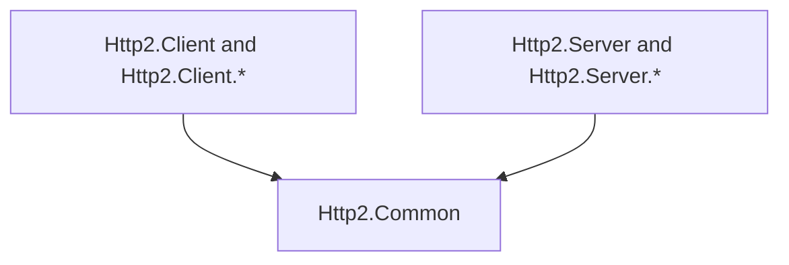

# Common architecture

## Public entry units

The combined library has three public entry units. `Http2.Common` provides
shared protocol types and operations. `Http2.Client` provides client factories,
requests, responses, and the client API. `Http2.Server` provides server
factories, handlers, requests, and responses.

The common implementation has no dependency on client or server units. Client
units depend on common units and client units. Server units depend on common
units and server units. Client and server units do not depend on each other.
Interface dependency cycles are not part of the design.

The library source directories are `src/common`, `src/client`, and
`src/server`. Each directory contains the units with its matching namespace.
No library unit is directly under `src/`. A client build uses the common
and client search paths; a server build uses the common and server search
paths. A combined build uses all three directories.

## Shared protocol ownership

`Http2.Common.Errors` owns the common exception hierarchy and error codes.
`Http2.Common.Headers` owns the shared header API. `Http2.Common.Hpack` owns
the header compression codec and records. `Http2.Common.Frames` owns frame
formats and shared settings operations. `Http2.Common.FlowControl` owns
connection and stream credit operations.

The client and server retain separate transport, connection, HTTP/1.1, TLS,
WebSocket, and event-stream behavior. Similar names do not make these role
contracts identical. The client and server `IBodyWriter` contracts remain
distinct. A consumer that uses both roles names the role-qualified type.

The client Readers helpers remain optional. The core client package does not
load JSON or XML reader dependencies.

## Review status

This document records the approved target design. The final unit interfaces,
package membership, and dependency edges need review against the merged source.
No build result is stated here.
